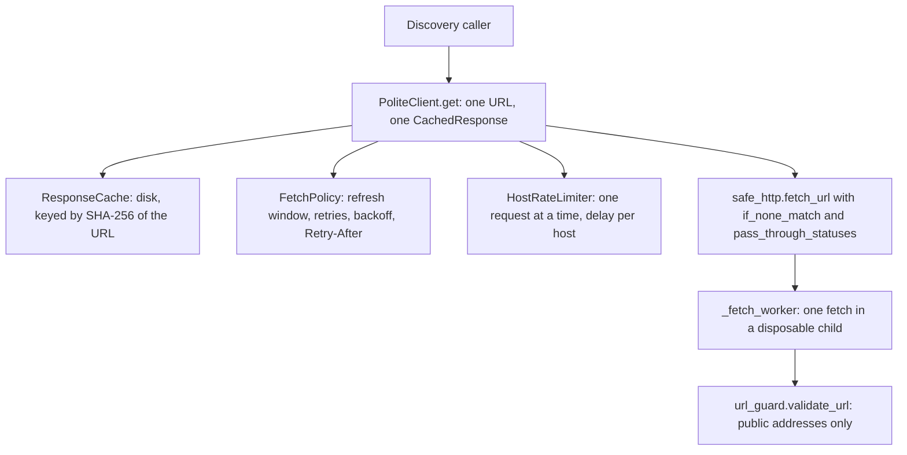
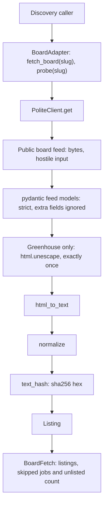
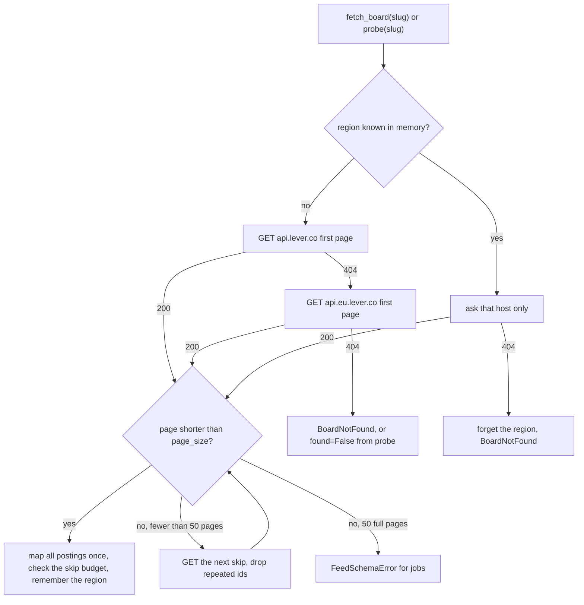

# Ingestion network architecture

Untrusted posting URLs enter `ingest.fetch.fetch_posting`, which calls `ingest.safe_http.fetch_url` for bounded response bytes. Discovery callers may use `fetch_url` directly. The posting fetcher does not extract HTML or PDF text, store a posting, call a model, or apply to a job. Those steps belong to separate components.

```mermaid
flowchart LR
    posting[Posting caller] --> fetcher["fetch_posting: raw bytes and typed failures"]
    fetcher --> parent["safe_http.fetch_url: deadline and worker"]
    discovery[Discovery caller] --> parent
    parent --> worker["_fetch_worker: one fetch"]
    worker --> guard["url_guard.validate_url: parse and resolve"]
    guard --> target["ValidatedTarget: host and public IP"]
    target --> request["HTTPX GET to numeric IP"]
    request --> identity["Host header and TLS SNI: validated hostname"]
    request --> stream["Raw stream: wire, decoded byte and gzip ratio caps"]
    request -->|redirect, at most three| guard
    stream --> response["FetchResponse: final URL, status, content type, bytes"]
    response --> result["FetchResult: bytes, type, provenance"]
    result -->|HTML body, separate library call| html["html_to_text: visible text and warnings"]
    html --> normalize["normalize: bounded posting text"]
```

The worker calls the F1a guard at the first URL and at every redirect. The guard validates all DNS answers and returns the chosen IP. HTTPX connects to a numeric-IP URL, with the validated hostname in `Host` and its documented `sni_hostname` extension for certificate verification. Each hop uses a fresh client with redirects disabled and `trust_env=False`, so environment proxies and credentials cannot change where it connects. No cookies are replayed. The fragment is omitted from the request, while encoded path and query bytes are preserved. Redirect `Location` text is checked for literal controls, whitespace and backslashes before joining and validation.

Every request, including redirects, sends `User-Agent: cypress-creek/<installed version> (personal job search tool; +https://github.com/jpalicke/cypress-creek-job-board)` and `Accept-Encoding: gzip`. The version comes from package metadata. This identifies the tool honestly at the network boundary; it does not add browser execution, authentication or a user-facing posting workflow.

Only HTTP and HTTPS on ports 80 and 443 can pass the production URL guard. The independent provider adapter talks to its operator-configured model API, normally loopback, under the provider configuration rule. Its `httpx` use is explicitly allowed by the HTTP-import audit; it does not accept posting or discovery URLs. A provider's `allow_remote` setting cannot change the posting URL policy. `fetch_posting` and future discovery fetchers call `fetch_url`, never an HTTP client directly.

`fetch_posting(url)` uses fixed transport limits and returns raw `body` bytes, normalized `content_type`, and provenance containing the requested and final URLs, byte count, UTC retrieval time, `raw-fetch` extractor name, installed package version, and a warning when a redirect changes host. It raises `BlockedByPolicy` with the URL guard's stable reason code for a rejected URL or redirect, `TooLarge` for byte or decompression-ratio caps, `UnsupportedContent` for a missing or disallowed content type, `Empty` with guidance to paste the posting text manually for a zero-byte body, and `FetchFailed` for other transport failures. A server response of HTTP 401 is the narrow `NeedsBrowser` signal with the same manual-paste guidance. Other non-success statuses, including HTTP 403, remain `FetchFailed`; arbitrary HTML is returned as bytes for the later extractor to assess. These exceptions use generic messages and do not include hostile URLs or response text.

The transport also supports polite repeat fetching. `fetch_url(url, if_none_match=..., pass_through_statuses=True)` sends a validated `If-None-Match` value on every hop and, instead of raising, returns an empty-body `FetchResponse` for HTTP 304, 404, 429 and 5xx with the status and any `etag` and `retry_after` header values (printable ASCII, 512 characters at most, otherwise `None`). A bad `if_none_match` raises `SafeHttpError` with reason `invalid_validator`. Callers needing JSON pass `FetchLimits(content_types=frozenset({"application/json"}))`. `fetch_posting` uses neither option, so its behavior is unchanged.

For an HTML response, a caller passes the body to `html_to_text`, then normalizes the extracted text. The parser does not fetch resources or execute scripts. It excludes supported hidden content and conservative navigation, footer and cookie boilerplate, reports hidden elements, and rejects inputs above 10 MiB or 128 nested elements. Empty extracted text needs manual paste. See [the pipeline guide](pipeline.md#html-posting-text) for usage.

The public call starts a disposable Python child and grants one deadline for worker startup, operating-system DNS, all redirects, headers and body reading. A missed deadline kills and reaps the child, including a blocked resolver. The operating system can delay process creation and cleanup, so the configured timeout bounds worker activity rather than promising an exact return time. HTTPX also applies a connect timeout. Errors crossing the worker boundary are typed reason codes with generic messages, never a response body, URL, credential or socket error.

The final response body is read from raw network chunks. The defaults allow at most 10 MiB of wire data and 10 MiB of decoded data, with a 100:1 decoded-to-wire ratio. Only identity or one complete gzip stream is accepted; malformed, truncated and concatenated gzip streams fail. These byte caps govern the final body; redirect bodies are not read. The default content types are HTML, XHTML, plain text and PDF. A missing or different type fails. Callers may narrow the limits and type set, but cannot enable private URLs through any production argument, config field or environment variable.

The small loopback test entry lives only in `tests/http_support.py`. It substitutes a resolver for a named fixture inside the private transport function and worker; production `fetch_url` always invokes the worker with `validate_url`. Real local HTTP servers test redirects, limits, timeouts and cookie isolation. A real UDP DNS responder changes its answer between queries to test that the transport connects to the first validated IP. That rebinding test is compositional: the F1a public-address policy has independent tests, and the local fixture alone does not claim a production OS-DNS end-to-end rebinding proof.

## Polite fetching

Discovery code never calls `fetch_url` directly. It calls `PoliteClient.get(url)`, which adds the politeness rules described in [the README](../README.md#discovery-findings-and-sources) on top of the guarded transport. The layering, outermost first:

`get` works in this order. It reads the cache. An entry younger than the refresh window (900 seconds by default) is returned with no request. Otherwise it sends a request, waiting first for the limiter, with the stored ETag as `If-None-Match`. A 429 or 5xx is retried after a backoff delay. A 304 returns the cached body. A 2xx replaces the cache entry. Every request, including each retry, passes through the limiter and through the URL guard.

**Result semantics.** `get` returns a frozen `CachedResponse`:
- `status` is 200 when the body came from a download or from a hit inside the refresh window, and 304 after a revalidation that the server confirmed. Callers can tell a window hit from a download with `from_cache`: it is `True` for a window hit and for a 304, `False` for a download.
- `fetched_at` is wall clock seconds since the epoch, taken when the body was last downloaded or revalidated. A 304 restamps the cache entry, so the refresh window restarts from the revalidation. A window hit reports the stored time and does not touch the entry.
- `url` is the requested URL, kept so every posting can link back to its source for attribution.
- `body` is the raw bytes and `etag` the stored validator, or `None`.

**Typed errors.** Every failure is a stable reason code with a generic message. None carries the remote body or the URL.
- `RetriesExhausted` (`retries_exhausted`) when the last allowed attempt still got a 429 or 5xx. It exposes `last_status`.
- `NotFound` (`not_found`) when the server answers 404. Nothing is written to the cache.
- `UnexpectedNotModified` (`unexpected_not_modified`) when the server answers 304 and there is no cached entry to serve. The client only sends `If-None-Match` when it has an entry, so this means the cache changed or the server misbehaved.
- `SafeHttpError` and `UrlGuardError` from the transport propagate unchanged, for example a blocked address, a wrong content type, a timeout or an oversize body. They are not retried.
- `FetchConfigError` comes from `FetchPolicy.from_environment` and names the setting, never its value.

**Retries and backoff.** The number of attempts is `max_retries + 1`, so `max_retries=0` means one attempt and no retry. `max_retries` is at most 8. Between attempts the client sleeps for an exponential delay from a 1 second base, capped at 60 seconds, with caller supplied jitter that spreads the delay over the upper half of the window (never below half). A usable `Retry-After` header (delta-seconds or an HTTP-date, a past date meaning zero) can only lengthen the wait, and is itself capped at 60 seconds, so a hostile header cannot stall the client for hours. An unparseable header is ignored. Only 429 and 5xx are retried. A 404 is not retried and is never cached: the client raises `NotFound` (`not_found`). Other non-success statuses, such as 403 and 410, raise `SafeHttpError` with reason `http_status` from the transport and are not retried.

**Timing.** The limiter measures the delay from the end of the previous request, not its start, and the client uses wall time only to stamp and age cache entries. [ADR 0019](adr/0019-polite-fetch-timing-and-clocks.md) records why. All timing goes through an injected `Clock` (`SystemClock` in production, `ManualClock` in tests), so the delay, window and backoff logic is tested without sleeping.

**The test-only fetch seam.** `PoliteClient` takes `fetch` (default `fetch_url`) and `random_source` (default `random.random`) as constructor arguments. Production code uses the defaults. Tests use `fetch` to point the transport at a real local server by name, and to record the time of each attempt, and `random_source` to make jitter deterministic. The seam substitutes the address lookup, never the HTTP exchange, so a test still talks to a real server. It adds no mock mode.

See [the threat model](threat-model.md) for rules, error reasons and executable test commands, and [ADR 0013](adr/0013-pinned-http-transport.md) for the HTTP client and deadline choices.

## Board adapters

An adapter reads one ATS board and returns listings in the common shape. Adapters only issue GET requests, only through `PoliteClient`, and never touch an apply endpoint. Code that needs a board depends on the `BoardAdapter` protocol in `discovery/adapters/base.py`, not on a vendor. Three adapters exist, `GreenhouseAdapter`, `LeverAdapter` and `AshbyAdapter`. They share the strict feed model base and the text cleanup in `discovery/adapters/feed_common.py` (`FeedModel`, `field_path`, `plain_line`).

**The interface.**
- `fetch_board(slug) -> BoardFetch` returns every well formed job on the board as `listings`, and each malformed job as a `SkippedJob` in `skipped`. `SkippedJob` holds the job's `index` in the feed, its `job_id` when plain, the `field` and a `reason_code`, never a feed value. `BoardFetch.unlisted` is the number of jobs the feed marks as not listed. Those are dropped on purpose, so they are neither listings nor skips (it is `0` for an adapter whose feed has no such flag).
- `probe(slug) -> ExistenceResult` says whether the board exists. `ExistenceResult(found, organization_name)` carries the organization name the ATS reports, which is the strong identity evidence for a suggestion. A result with `found=False` cannot carry a name. Lever and Ashby report no name, so their probes return `found=True` with `organization_name=None` and the slug is the identity.
- `Listing` is a frozen dataclass shaped like a row of the listing table: `id`, `ats`, `slug`, `title`, `location`, `url`, `posted_at` (timezone aware, or `None`), `fetched_at` (UTC), `content_text`, `content_hash` and `state` (`ListingState`: `new`, `seen`, `closed`; an adapter always emits `new`). `listing_id(ats, slug, job_id)` is the one id format, `ats:slug:job_id`, for example `greenhouse:acme:12345`.

**Typed errors.** All derive from `AdapterError` and carry a stable `reason_code`. None echoes a value taken from a feed.
- `FeedSchemaError` (`feed_schema`) names the field path of the first problem, such as `jobs[3].title`, and never the value or the validator message.
- `BoardNotFound` (`board_not_found`) names the ATS and the slug the caller supplied.

**The Greenhouse mapping.** `GreenhouseAdapter` reads `/v1/boards/{slug}/jobs?content=true` for a board and `/v1/boards/{slug}` for the probe. For each job it validates the shape on its own, then turns the description into text in a fixed order: unescape the HTML entities exactly once (the feed escapes the description HTML inside JSON), `html_to_text`, `normalize`, then `text_hash` of the normalized text. Titles and locations are normalized to one plain line with control characters stripped. [ADR 0020](adr/0020-adapter-failure-modes.md) and [ADR 0021](adr/0021-per-job-skipping.md) record the choices below.

**The Lever mapping.** `LeverAdapter` reads `/v0/postings/{slug}?mode=json&limit=N&skip=M`. Each response page is a bare JSON array of postings. The adapter gathers every page, then maps the whole board at once, so the skip budget and the `SkippedJob.index` apply over the board and not per page. For each posting it validates the shape on its own. The title is `text`, the location is `categories.location`, the URL is `hostedUrl`, and `createdAt` (epoch milliseconds) becomes a timezone aware `posted_at`. The description is real HTML, not escaped HTML, so there is no `html.unescape` step. Its text is `description`, then each `lists` entry's heading (one plain line) and `content`, then `additional`. Each part goes through `html_to_text` on its own, the parts are joined by blank lines, and the result goes through `normalize` and `text_hash`. The posting id must be short and plain (letters, digits, `_` and `-`, at most 64), because it becomes part of the listing id `lever:slug:id`. [ADR 0022](adr/0022-lever-pagination-and-region.md) records the choices below.

- **Paging.** `page_size` is 1 to 100 (default 100). A page shorter than `page_size` ends the board, and an empty page ends a board whose size is an exact multiple. `MAX_PAGES` is 50, so a board still full after 50 pages raises `FeedSchemaError` for `jobs` instead of returning a truncated board. A posting id that arrives on a second page is dropped, and the first copy stays.
- **Region.** `probe` and a first `fetch_board` ask the US host, then the EU host, one request at a time. Only a 404 moves on to the next host, and any other refusal propagates. `region_of(slug)` returns the host a board was found on (`LeverRegion.US` or `LeverRegion.EU`), or `None`. The adapter never writes it to disk. `remember_region(slug, region)` seeds it from a region stored on the watchlist entry (`Watchlist.set_region`, [ADR 0024](adr/0024-lever-region-is-stored-on-the-watchlist-entry.md)), so a fresh process asks only that host. A 404 from a remembered host, or on a later page, forgets the region and raises `BoardNotFound` without trying the other host.
- **Probe.** `probe` requests one posting (`limit=1`). A board with no open postings answers 200 with `[]` and is found. A 404 from both hosts is `found=False`.

**The Ashby mapping.** `AshbyAdapter` reads `{base}/{name}`, where the base defaults to `https://api.ashbyhq.com/posting-api/job-board` (`DEFAULT_BASE_URL`, overridable with `base_url`). A board is one response, a JSON object with a `jobs` list, so `fetch_board` and `probe` each make one GET with no query string, and no compensation data is requested. For each job it validates the shape on its own. The title is `title`, the location is `location` (optional, empty when missing), the URL is `jobUrl` (http or https), and `publishedAt` becomes a timezone aware `posted_at` (`None` when missing). `isListed` is required. The description is `descriptionPlain` when it has any text, else `descriptionHtml` through `html_to_text`, then `normalize` and `text_hash`. There is no `html.unescape` step. The job id must be short and plain (letters, digits, `_` and `-`, at most 64), because it becomes part of the listing id `ashby:slug:id`. [ADR 0023](adr/0023-ashby-unlisted-jobs-probe-shape-and-weak-etag.md) records the choices below.

- **Unlisted jobs.** A job whose `isListed` is the JSON `false` is dropped and counted in `BoardFetch.unlisted`. The check runs before any other validation, so an unlisted job never causes a skip. The skip budget is counted over the listed jobs only (jobs minus unlisted), so a mostly unlisted board is not a schema failure. A job with `isListed` missing or not a boolean is malformed and is skipped, never assumed listed.
- **Probe.** A 404 is `found=False`. A 200 is `found=True` with `organization_name=None` when its body is a JSON object with a `jobs` list, which may be empty. A 200 of any other shape raises `FeedSchemaError`. The probe does not read individual jobs, since a malformed job is a skip that `fetch_board` counts. Ashby has no limit parameter, so the probe reads the whole board from the same URL as `fetch_board`, and the polite client's cache serves the fetch that follows.
- **Weak ETag.** Ashby sends `ETag: W/"job-board:..."`. The cache stores it as received and sends it back unchanged as `If-None-Match`, and the real server answers 304. A 304 revalidation and a hit inside the refresh window both report `from_cache` as true, with status 304 and status 200 respectively.

**Failure modes.** The table applies to both adapters unless a row names one.
| Cause | What the adapter does |
| --- | --- |
| One job is malformed (a missing or mistyped field, an over long value, a non http(s) job URL, an empty title or description) | The job is skipped and listed in `BoardFetch.skipped` with its index, field and reason. The rest of the board is returned. A caller must not treat a fetch with skips as a full snapshot. |
| More than 10 percent of a board's jobs are malformed, or the body or `jobs` list has the wrong shape | Raises `FeedSchemaError` naming the field (`jobs` for the budget). The whole board is skipped, visibly. Other boards are unaffected because the error is per call. |
| HTTP 404 for the slug (Lever: from both hosts) | `fetch_board` raises `BoardNotFound` so the caller can mark the watchlist entry broken. `probe` returns `found=False` without raising. |
| Lever: the body is not a JSON array | Raises `FeedSchemaError` naming `$`, the whole body. |
| Ashby: a job has `isListed` false | The job is dropped and counted in `BoardFetch.unlisted`. It is not a listing, not a skip, and not part of the skip budget. |
| Ashby: the body is not an object with a `jobs` list | Raises `FeedSchemaError` naming `$` or `jobs`. `probe` raises it too for a 200 of that shape, so it is never reported as a board. |
| Lever: the board is still full after 50 pages | Raises `FeedSchemaError` naming `jobs`. No partial board is returned. |
| Lever: the same posting id on two pages | The first copy is kept and the later one is dropped. |
| HTTP 403, 410 or any other refused status | Propagates as `SafeHttpError` (`http_status`). It is never reported as a missing board. |
| 429 or 5xx after the allowed retries | Propagates as `RetriesExhausted`. |
| A blocked address, wrong content type, timeout or oversize body | Propagates from the transport unchanged. |

**Limits.** `GREENHOUSE_FETCH_LIMITS` allows 64 MiB on the wire and decoded, a 60 second total timeout and `application/json` only, because a large board with full descriptions is many megabytes. Titles, locations and board names are at most 1000 characters and a job URL at most 2048. There is no pagination: one response holds the whole board.

`LEVER_FETCH_LIMITS` allows 16 MiB on the wire and decoded, a 60 second total timeout and `application/json` only. A real page of 100 postings with full descriptions measured 1.9 MB on 2026-10-14, so the cap is about eight times that. Titles, locations and list headings are at most 1000 characters and a posting URL at most 2048. The client must be built with these limits.

`ASHBY_FETCH_LIMITS` allows 16 MiB on the wire and decoded, a 60 second total timeout and `application/json` only. A real board of 63 jobs with full descriptions measured 1.95 MB on 2026-10-19, so the cap is about eight times that. Titles and locations are at most 1000 characters and a job URL at most 2048. There is no pagination: one response holds the whole board. The client must be built with these limits.

The adapter does not decide what to do with an error. The caller (the scan, later cards) turns `BoardNotFound` into a broken watchlist entry and any other error into a visible failure for that board only.
