# Codebase guide

For a developer new to the project. Read the [README](../README.md) first, then this page, then pick up a card from the issue board.

## What the project does, in one paragraph
You give it a job posting. It pulls out the requirements, looks each one up in your personal fact bank (a YAML file of verified claims about your own work), reports honestly where you have no support, and only then helps draft an application. Every claim in the output must cite a verified fact. That is enforced by deterministic code (validators), never by prompting a model to behave. A human reviews every draft and nothing is ever sent automatically.

## The rule that shapes every decision
Nothing the tool outputs may assert a claim that is not backed by a verified fact ID in the fact bank. When you are unsure whether a change is allowed, ask whether it could let an unverified claim through. If so, it is not allowed. Model output is untrusted data until a validator passes it. All external input (postings, PDFs, feeds, model output) is hostile.

## Layout
```
config/                  Data that behaves like code but is edited by hand
  aliases.yaml           Tag alias table (requirement term to canonical tag)
  weights.yaml           Score weights and support values
  confusables.txt        Unicode confusables data (UTS #39), unmodified, used by company_key
docs/                    Documentation, indexed in docs/README.md
  adr/                   Decision records, one per design decision
scripts/                 Repo tooling run by hooks and CI (ABOUTME check, license check)
src/cypress_creek/       The library
  terms.py               normalize_term: the one term normalizer
  eval_records.py        Typed eval records, identity checks and JSONL export reader
  eval_store.py          Transactional SQLite eval runs and JSONL audit export
  facts/                 The fact bank
    models.py            Fact, Tag, Evidence, Bank and their enums
    loader.py            Safe YAML loading, parse_bank, load_bank
    dates.py             Date sanity rules
    hashing.py           bank_hash: the one definition of the fact bank hash
    errors.py            BankLoadError, FactValidationError
  pipeline/              Stages that build model prompts (extraction wording lives in prompts/)
    prompt.py            Stage, Prompt (with user_message), build_prompt, prompt_facts, PromptError
    retrieve.py          retrieve, RequirementCandidates, MAX_CANDIDATES: tag and alias retrieval, no model
    schemas.py           ExtractionOutput, ProposedRequirement, EntailmentOutput, EntailmentVerdict, DraftOutput: the shapes the models answer in
    extract.py           extract_requirements, ExtractionResult, accept_proposals, Acceptance, Dropped, DropReason
    entail.py            entail, judge, EntailedMatch, Entailment: stage 3, the verdict only lowers support
    draft.py             draft, judge_draft, render_draft, Draft: optional draft help, every sentence checked, nothing is sent
    report.py            GapReport, build_report, verify_report, ReportRefused: stage 4, the report as data
    render.py            render_text: stage 5, the plain text view of a report
    version.py           pipeline_version, fingerprint: a digest of the stages, prompts, validators, scoring code and config, part of the discovery cache key
    run.py               analyze, assess, run_id: the whole run, with provenance and a run id derived from its inputs
    trace.py             PipelineTrace, CallRecord, ValidatorRecord: observed calls and validator verdicts
    prompts/             Versioned system texts, one file per stage and version (extract_v2.txt, entail_v1.txt, draft_v1.txt)
  ingest/                Untrusted posting text in, clean models out
    models.py            Posting, Requirement, typed warnings
    normalize.py         normalize(), text_hash()
    hashing.py           The one definition of the text hash
    errors.py            PostingTooLong, EmptyPosting
    url_guard.py         validate_url, immutable ValidatedTarget, UrlGuardError with reason codes
    safe_http.py         fetch_url, FetchLimits, FetchResponse, SafeHttpError; pinned, bounded HTTP
    fetch.py             fetch_posting, FetchResult, provenance and typed posting fetch errors
    html_text.py         html_to_text, ExtractedText, hidden warnings and typed size/depth errors
    build.py             build_posting, new_posting_id: the one way text becomes a Posting
    link_posting.py      posting_from_url, posting_from_fetch, posting_from_pdf: a fetched link or an uploaded PDF becomes a Posting
    pdf_text.py          extract_pdf_text: the visible text of a PDF from a limited child process, with typed PdfError subclasses
    pdf_worker.py        the child process entry point: limits first, then pypdf, hidden text dropped and counted
    _fetch_worker.py     Disposable fetch process that bounds blocking DNS by a whole-fetch deadline
  validators/            Grounding validators V1 to V14, pure functions returning Verdicts
    verdict.py           Verdict, ok(), fail()
    cues.py              The one list of importance cue words, sentence splitting
    extraction.py        V1 schema, V2 verbatim span, V3 importance cues
    citations.py         V4 fact exists, V5 fact verified, V6 fact shareable
    consistency.py       V7 entity consistency, V8 numeric consistency
    claims.py            V9 citation required, V10 novel term flag
    requirements.py      V11 cap and dedupe, V13 cue sentence coverage
    fact_dates.py        V12 date sanity (wraps facts/dates.py)
    names.py             V14 company name shape
    claim_words.py       Quantity words (V8) and the negation list the draft check uses
    vocabulary.py        The closed vocabulary for drafts: function words, inflection rule, character check
    registry.py          REGISTRY: id, name, rule and function for each validator
  providers/             The model backend interface, typed errors and retry policy
    base.py              Provider protocol, Capabilities, CostPerMtok, Usage, StructuredResult, estimate_input_tokens
    errors.py            ContextTruncated, SchemaViolation, ProviderUnavailable, RateLimited, BudgetExceeded, Refusal
    retry.py             call_with_retry, RetryPolicy
    factory.py           get_provider, ProviderRegistry, UnknownProvider
    ollama.py            OllamaProvider and its pre-flight and post-flight truncation checks
    anthropic.py         AnthropicProvider: Messages API request, strict schema rewrite, response and error mapping
    openai_compatible.py OpenAICompatibleProvider (OpenAI and LM Studio), build_request, read_completion
    strict_schema.py     strict_schema, close_schema: a pydantic schema in the strict subset a hosted API accepts; the caller passes its own keyword set (`OPENAI_UNSUPPORTED_KEYWORDS`, `ANTHROPIC_UNSUPPORTED_KEYWORDS`, each defined next to its adapter)
    budget.py            Budget, BudgetTracker, BudgetedProvider, dry_run_estimate, budget_from_settings
  config/                Backend settings (not the repo level config/ data folder)
    settings.py          ProviderSettings, load_settings, is_loopback_url, resolve_api_key, ConfigError
  api/                   The local FastAPI app (see api.md)
    app.py               create_app: wires the headers, the Host check, the CSRF middleware, typed errors and routes
    security.py          allowed_hosts, HostCheckMiddleware, CsrfMiddleware, SecurityHeadersMiddleware, new_token, API_PORT
    errors.py            ErrorCode, ApiError, ErrorResponse and the handlers for the one error shape
    server.py            main, check_bind_host: the uvicorn entry point (`cypress-creek-api`)
    routes/              health.py, providers.py, session.py, postings.py, reports.py, facts.py, watchlist.py, blacklist.py, discovery.py (one router each)
    context.py           Database (created on first use), Backend, and the dependencies the routes share
    schemas.py           Request and response models for the posting, analyze, report and fact routes
    backends.py          check_backend_choice: name the configured backend, confirm a hosted one
  storage/               Mutable state: the company name key and the SQLite database
    company_key.py       company_key, load_confusables: the one company name normalizer
    repository.py        PostingStore, ReportStore, StoredReport, StoredVerdict, prepare_database
    db.py                data_dir, connect, migrate, schema_version, MigrationError
    migrations/          Numbered .sql files, including 0003_blacklist.sql, 0004_eval_runs.sql 0005_watchlist_region.sql, 0006_postings_reports.sql and 0007_discovery_reports.sql
  discovery/             Discovery state in SQLite, the polite fetch layer over the guarded transport, and the ATS board adapters
    watchlist.py         WatchlistEntry, Watchlist, Tombstoned, AlreadyWatched, IdentityEvidence
    tombstones.py        Tombstones, Denial, DenialReason, normalize_board: denied companies kept as denied suggestion rows
    listings.py          Listings, StateChanges: the listing table, with new, seen and closed transitions from a successful board fetch
    dedupe.py            dedupe, MergedListing, fingerprint_text: conservative merge by listing id, then exact cross source fingerprint
    run.py               run_discovery, ranked_listings, rank, unblocked_entries, board_keys, RunIdentity, RankedListing, RunSummary: blacklist, fetch, dedupe, filter, score under a cap with a run id cache, rank
    factory.py           default_adapters, seed_lever_regions: the three real adapters over one polite client each, and the stored Lever regions
    filters.py           ListingFilters, apply_filters, FilterReport, FilterName: deterministic keyword, location, remote, seniority and age filters
    blacklist.py         The pure filter: is_blacklisted, Candidate, BlacklistEntry, BlockReason, normalize_slug, normalize_domain, InvalidBlacklistValue
    blacklist_repository.py  Blacklist (add, remove, rows, entries) and AlreadyBlacklisted: stores and loads entries, no matching
    fetch_policy.py      FetchPolicy, FetchConfigError, parse_retry_after: refresh window, host delay, retries and backoff, read from env
    rate_limiter.py      Clock, SystemClock, ManualClock, HostRateLimiter: per host spacing over an injectable clock
    cache.py             ResponseCache, CacheEntry, default_cache_dir: disk cache keyed by a hash of the URL
    polite_client.py     PoliteClient, CachedResponse, PoliteFetchError, RetriesExhausted, UnexpectedNotModified, NotFound: the one discovery fetch entry
    adapters/            One module per ATS: public board feed in, normalized listings out
      base.py            Listing, ListingState, listing_id, ExistenceResult, BoardFetch, SkippedJob, SkipReason, check_skip_budget, BoardAdapter, AdapterError, FeedSchemaError, BoardNotFound
      feed_common.py     FeedModel, field_path, plain_line: the strict feed model base and text cleanup both adapters share
      greenhouse.py      GreenhouseAdapter, GREENHOUSE_FETCH_LIMITS, parse_jobs_response, parse_board_name
      lever.py           LeverAdapter, LeverRegion, LEVER_FETCH_LIMITS, MAX_PAGES, load_postings, map_postings, parse_postings_response
      ashby.py           AshbyAdapter, ASHBY_FETCH_LIMITS, DEFAULT_BASE_URL, parse_board_response
  scoring/               Deterministic scoring, no model calls
    aliases.py           AliasTable, load_aliases
    support.py           candidate_facts, merged_years, support_ceiling
    score.py             Weights, load_weights, Match, downgrade, score, ScoreResult
evals/
  bank/                  The fictional sample fact bank, its unverified lure file and PLANTED_GAPS.md (see evals.md)
  cases/                 Dated fictional postings; technical-smoke.json is the CLI smoke case
  harness/run.py         Dry-run planner and resumable real-provider CLI over a manifest or the labeled fixtures
  harness/labels.py      Hand label schema, validate_labels, planted_gap_support, require_committed_labels
  harness/fixtures.py    Fixture loading, the meta schema and fixture_set_hash
  harness/check_labels.py  Command line check of every posting fixture
  harness/metrics.py     The E1 to E4 metric definitions: score_case, pool, repeat_values, aggregate
  harness/injection.py   The injection corpus loader and the E6 metrics: load_injection, score_pair, injection_values
  harness/score.py       The scorer CLI: run files and committed labels in, a metrics JSON and a mismatch view out
  harness/table.py       The comparison table builder: collect_rows, render_table, update_readme, and the --check CLI
  backends.yaml          The backends the table must list (data, edit freely)
  fixtures/<ats>-<job id>/  One real posting: posting.txt, meta.yaml, labels.yaml (see evals.md and NOTICE)
  fixtures/injection/<case id>/  A hand written hostile case: attacked.txt, its clean.txt twin and payload.yaml (see evals.md)
  scratch/               Gitignored local JSONL exports
  results/               Published labeled JSONL exports only after E3 labels exist
tests/
  unit/                  Pure functions and models, including the Anthropic request, schema rewrite and response parsing, the strict schema helper, eval case loading and dry-run planning, fetch policy and limiter, adapter contract, Greenhouse, Lever and Ashby feed mappings, and the Lever region on a watchlist entry and adapter seed
  component/             Real files and local servers, including the discovery refresh and listing routes over a real database and loopback boards, the watchlist and blacklist routes over a real database, the Anthropic and openai_compatible adapters over real HTTP (wire request, error mapping, retry, budget guard), the no-network eval CLI dry run, response cache, polite client, and the Greenhouse, Lever and Ashby adapters (Lever on US and EU path prefixes, Ashby also answering a weak ETag with a 304)
  integration/           Public DNS and feeds (needs_network, including the list routes making no lookup and the discovery routes over real Lever boards), a live discovery run with a real model, also through the discovery routes, dedupe, filters and listing states over a real public board, real Ollama eval runs and failure persistence, the live Anthropic call (needs a key, fails without one), the credentialed live_openai and live_lmstudio tests, and live Greenhouse, paged US and EU Lever (including a stored EU region that reaches the EU host with no US request), and Ashby boards (the probe, a made-up slug and a real weak ETag revalidation)
  e2e/                   Separate-process flows for the openai_compatible adapter against a loopback chat server, URL guard, posting fetch, HTML text, blacklist filtering, the watchlist and blacklist routes and a discovery refresh of a blacklisted board on the real server, a stored Lever region used by a fresh process, listing state refreshes and discovery score reuse across processes, and eval CLI resume of pending cases
  chat_server.py         Test-only real loopback chat completions server that records requests and plays a set reply
  discovery_support.py   Recorded Lever postings served by a loopback server, a real Lever adapter with a manual clock, and a scorer from hand written requirements
  api_support.py         A synchronous client that drives the real FastAPI app in process over httpx's ASGI transport
    eval_support.py        Test-only builders for hand made labels, reports and run files used by the scorer tests
  http_support.py        Test-only real HTTP and UDP DNS servers with a loopback resolver; the HTTP server records methods and can route by query string for paged paths and answer an ETag with a 304
  fixtures/              Recorded or hand written inputs
    extraction/          A posting and a recorded real model output for the accept step
    html/postings.json   Anonymized excerpts of three public ATS posting layouts
    greenhouse/board_responses.json  Hand written board and jobs responses, including hostile ones, for the adapter tests
    lever/palantir_page.json  A byte for byte recording of three postings from the live public feed (`?mode=json&limit=3`, 2026-10-14), the base of the Lever mapping and adapter tests. The tests copy and mutate it to build hostile cases. Its source and terms are listed in NOTICE
    ashby/ashby_board.json  The first three jobs of a recorded real board response (2026-10-19), the base of the Ashby mapping and adapter tests. The tests copy and mutate it to build hostile cases, and edit it to mark a job unlisted, since no live board had one. Its source and terms are listed in NOTICE
    hostile_outputs/     One bad model output per validator, plus a small bank (see validators.md)
  conftest.py            Fails the run if any test is skipped
```
`facts.private/` is where your own bank lives. It is gitignored and never committed.

## How the pieces fit today

```mermaid
flowchart LR
    url[Untrusted URL] --> fetcher["ingest.fetch.fetch_posting(): raw bytes + provenance"]
    fetcher --> transport["ingest.safe_http.fetch_url(): pinned HTTP transport"]
    transport --> guard["ingest.url_guard.validate_url()"]
    resolver[Operating system DNS] --> guard
    guard --> target["ValidatedTarget: scheme, host, ip, port"]
    target --> request["numeric-IP HTTP GET"]
    request --> response["bounded response bytes"]
    response --> fetched["FetchResult"]
    fetched -->|HTML bytes| html["ingest.html_text.html_to_text()"]
    html --> norm
    raw[Raw posting text] --> norm["ingest.normalize()"]
    norm --> posting[Posting]
    posting --> extract["pipeline.extract_requirements()"]
    extract --> reqs[Requirements]
    extract -. attempted calls .-> trace["PipelineTrace: calls + verdicts"]
    migs[(storage/migrations/*.sql)] --> migrate["storage.migrate()"]
    migrate --> db[(data/cypress_creek.sqlite3)]
    cases[(evals/cases/*.json)] --> evalrunner["evals.harness.run: dry run or live run"]
    sample[(evals/bank/sample_bank.yaml)] --> evalrunner
    evalrunner -->|dry run| plan["dry_run_plan: no provider calls"]
    evalrunner -->|live run| budgeted["BudgetedProvider: whole-run cap"]
    budgeted --> extract
    trace --> evalrunner
    evalrunner --> evalstore
    evalstore["EvalStore: transactional eval runs"] --> db
    evalstore --> export[(evals/scratch/*.jsonl audit export)]
    bank[(facts.private/bank.yaml)] --> load["facts.load_bank()"]
    load --> verified["Bank.verified_facts()"]
    aliases[(config/aliases.yaml)] --> table[AliasTable]
    reqs --> gate["scoring.support_ceiling()"]
    verified --> gate
    table --> gate
    gate --> ceiling["support + deciding gate"]
    ceiling --> score["scoring.score()"]
    score --> result["score, supported of total, inputs"]
    reqs -. model output .-> val["validators (V1 to V14)"]
    ceiling --> draftfn["pipeline.draft(): V4 to V10 per sentence, no support means no call"]
    draftfn -. actual verdicts .-> trace
    val -. actual verdicts .-> trace
    discovery[Discovery caller] --> polite["discovery.polite_client.PoliteClient.get()"]
    polite --> cachefile[(fetch_cache/ by URL hash)]
    polite --> limiter["HostRateLimiter and FetchPolicy"]
    polite --> transport
    discovery --> adapter["discovery.adapters.GreenhouseAdapter, LeverAdapter, AshbyAdapter: fetch_board, probe"]
    adapter --> polite
    adapter --> listings["Listing rows: id, title, location, content_text, content_hash"]
    listings --> store["discovery.listings.Listings.apply_fetch(): new, seen, closed"]
    store --> db
    listings --> dedupe["discovery.dedupe.dedupe(): exact merge"]
    dedupe --> filt["discovery.filters.apply_filters(): counts per filter"]
    filt --> drun["discovery.run.run_discovery(): cap, run id cache, rank"]
    drun --> analyzer["analyzer: pipeline.run.analyze over the listing text"]
    drun --> db
```

The diagram shows library components, not a running app workflow. The link fetcher returns raw bytes, and a caller can pass HTML bytes separately to the HTML text extractor before normalization. PDF text extraction and a user-facing app workflow remain later cards. Draft help exists as a library step (`pipeline.draft`) that returns checked data and sends nothing (see the issue board and the spec).

URL validation is a separate library entry point. It rejects unsafe syntax, resolves a hostname once, checks every address, and returns connection coordinates without fetching anything. `fetch_url` uses that selected IP for the connection while retaining the hostname for Host and TLS verification. It revalidates every redirect, bounds the final response and gives DNS resolution a whole-fetch deadline in a child process. The test audit restricts HTTP client imports to this transport and the separate Ollama provider adapter. `PoliteClient.get(url)` is the one entry point for repeat discovery fetches. It sits over the same `fetch_url` transport and adds a per host delay, a refresh window, an ETag disk cache and backoff on 429 and 5xx, then returns a `CachedResponse`. No discovery code calls `fetch_url` directly. See [Polite fetching](architecture.md#polite-fetching), [the setup guide](setup.md#fetch-a-job-board-politely) and [ADR 0019](adr/0019-polite-fetch-timing-and-clocks.md).

A board adapter sits on top of `PoliteClient`. It turns one public ATS board feed into `Listing` rows, and it only ever issues a GET through the polite client. See [Board adapters](architecture.md#board-adapters), the setup guide for [Greenhouse](setup.md#fetch-a-greenhouse-board), [Lever](setup.md#fetch-a-lever-board) and [Ashby](setup.md#fetch-an-ashby-board), [ADR 0020](adr/0020-adapter-failure-modes.md), for Lever paging and regions [ADR 0022](adr/0022-lever-pagination-and-region.md) and, for Ashby unlisted jobs, its probe and its weak ETag, [ADR 0023](adr/0023-ashby-unlisted-jobs-probe-shape-and-weak-etag.md).

See [the fetching architecture](architecture.md), [the SSRF rules and limits](threat-model.md), [ADR 0009](adr/0009-url-target-validation.md) and [ADR 0013](adr/0013-pinned-http-transport.md).

`fetch_posting(url)` is the one-off, user-initiated library caller. It applies the fixed transport policy and returns HTML, plain text or PDF bytes with requested and final URL provenance. Typed failures distinguish blocked targets, disallowed content, size limits, authentication and empty responses. HTML callers can then use `html_to_text` as a separate step. See [the setup guide](setup.md), [HTML extraction](pipeline.md#html-posting-text) and [ADR 0015](adr/0015-link-fetch-browser-signals.md).

## Ideas to know
- **One source of truth.** The bank file is the only record of facts. Verification is derived from `verified_on` and is never stored as a separate flag. The pipeline only ever sees `Bank.verified_facts()`.
- **Pure and deterministic.** Scoring functions take everything as arguments, including `today`. Nothing reads the clock or the network.
- **Coverage is visible.** V3 and V13 read the same cue word list. The report keeps uncovered cue sentences and their source offsets in `not_assessed`; the text view puts the count by the score without changing that score.
- **Data, not code.** Things a person should tune (the alias table, the score weights) or bundled third party data (the Unicode confusables) are files in `config/` (YAML for the alias table and weights, plain text for the confusables), loaded and validated, never hard coded. Provider settings are TOML, see [providers.md](providers.md#configuration).
- **Typed errors.** Failures are specific exception classes (`PostingTooLong`, `FactValidationError`), so callers and tests can tell them apart. Text is rejected, never silently cut or repaired.
- **Public URL targets.** `validate_url` raises `UrlGuardError` with a stable `reason_code` and a generic message. It never echoes the URL or resolver error. Every DNS answer must pass the address checks before any one is selected; one private answer rejects the entire result.
- **Pinned HTTP connections.** `fetch_url` connects only to the validated numeric IP, disables environment proxies and redirects, then handles redirects itself. Every hop sends a versioned, honest User-Agent. It returns bytes only after content-type and size checks. `SafeHttpError` has stable reason codes and generic messages.
- **Posting fetch boundary.** `fetch_posting` is the public one-off entry for posting links. It returns raw bytes and provenance, not normalized text. HTTP 401 yields `NeedsBrowser` with manual-paste guidance; ambiguous HTML stays bytes for the separate parser. Errors do not expose hostile response text.
- **HTML content boundary.** `html_to_text` drops non-content tags, supported hidden styles and attributes, plus conservative nav, footer and cookie boilerplate. It retains headings and list items as lines, reports hidden elements, and rejects input above 10 MiB or nesting above 128 elements. It does not run JavaScript or fetch resources; external CSS visibility is unknown. See [the pipeline guide](pipeline.md#html-posting-text).
- **Safe by default config.** Backends default to loopback only, going remote needs `allow_remote`, and keys come from the environment alone. Config errors never echo a submitted value.
- **Measured truncation signatures are refused.** The Ollama adapter estimates before the call and checks the reported count after it. It raises `ContextTruncated` when the estimate exceeds the configured context or the count matches a measured truncation signature. Other server behavior may need additional detection.
- **Hosted adapters send the minimum and hide the key.** The Anthropic adapter needs `allow_remote`, sends the system text and the untrusted block as separate fields (prompt building already drops `local_only` facts for a non local backend), offers no tools, never follows a redirect, and scrubs the key from every error. See [ADR 0025](adr/0025-anthropic-native-structured-output.md).
- **Spend is capped before it happens.** `BudgetedProvider` checks the worst case (estimate plus output cap) against the run limits before a call and records the server's real usage after it. Real usage above an estimate blocks the next call, so the guard fails closed.
- **Hostile text is data.** The injection corpus keeps attack payloads as files with the exact payload and its offset, next to a clean twin that differs only by that payload. The scorer reads reports, never the payload as an instruction. See [evals.md](evals.md#the-injection-corpus-and-the-e6-metrics).
- **Scoring reads recorded spans.** `ReportRow` carries the requirement's source span and whether the model tried to raise support, so the scorer matches rows to hand labels by offsets and counts attempted raises before the clamp. Both fields default for reports stored earlier; the scorer refuses a row with no span. The scorer needs committed labels and the run's own bank, and calls a metric with no measurement `not_run`, never 0. See [evals.md](evals.md#scoring-a-run).
- **Attempted failures count.** A provider error identifies whether a request was attempted and carries complete reported usage when known. The budget counts attempted failed requests, including reported tokens and cost. Unknown usage blocks later calls in that invocation; on eval resume, a context-sized input ceiling and the stage output cap are reserved for that attempt before another call. A preflight refusal spends no request. See [providers.md](providers.md#the-budget-guard) and [evals.md](evals.md#run-the-harness).
- **Posting text never leaves its block.** `build_prompt` puts the posting between boundary lines carrying a random 128 bit token, keeps it out of the system message and shows extraction no facts. It is the first layer only, the validators are the control.
- **The model proposes, code decides.** The extraction model gives text, kind and term. Spans, ids and importance are set by code, and text that is not in the posting is dropped with a reason. See `pipeline.md`.
- **Entailment can only lower support.** The model's verdict is clamped to the rule ceiling by code, and `Match` refuses support above its ceiling. A drop of any size is allowed. See [ADR 0011](adr/0011-entailment-can-only-lower-support.md).
- **A positive verdict must cite.** `judge` counts a `supports` or `partial` verdict with no valid citation (candidate, verified, shareable) as `does_not_support`, and withholds any rationale that fails V7 to V10. See `pipeline.md`.
- **A run id is derived, not random.** `run_id` hashes the posting, the fact bank, the backend and the model, so the same inputs give the same id and a changed input gives a new one. See `pipeline.md`.
- **Eval resume identity is stricter than report identity.** `RunHeader.run_id` hashes the complete eval header, including commit, prompts, schemas, fixture set, bank, case plan and repeats. `EvalStore` validates SQLite records and resumes only unrecorded case pairs; JSONL is a read-only export, and only a terminal record marks a run complete. This is separate from the pipeline report's `run_id`, which intentionally excludes prompt versions. See [evals.md](evals.md#run-record-format) and [ADR 0018](adr/0018-eval-run-identity.md).
- **Draft help can only show data.** `pipeline/draft.py` checks each sentence with V4 to V10, keeps failures visible as `NOT VERIFIED` and never as clean text, answers a gap with `no verified fact supports this` and no model call, and has no send, copy or apply path (a unit test audits its imports). The checks are heuristics (drafts use a closed vocabulary: every word must come from a cited fact, see `validators/vocabulary.py`), so every draft still needs a human read. See [pipeline.md](pipeline.md#draft-help).
- **The pipeline trace records what ran.** Pass a `PipelineTrace` to `analyze` or `assess` for per-attempt provider records and the actual validator verdicts. Extraction, entailment and report assembly append to the same trace. Missing usage is nullable, never guessed in the audit. The eval CLI persists completed case traces and failed terminal attempts through `EvalStore`; see [evals.md](evals.md#run-the-harness).
- **A report cites or is refused.** `build_report` ends with `verify_report` (V4, V5, V9), so a fabricated or unverified fact id never reaches a report. Failed stages make the report incomplete rather than quietly partial. See `pipeline.md`.
- **Retrieval is not a model.** `retrieve` matches tags and aliases, ranks and caps the candidates, and sets the support ceiling. A requirement with no candidate is a gap and costs no model call. See `pipeline.md`.
- **Hand labels are inputs, checked against the posting and the bank.** `validate_labels` refuses a label whose span is not exact posting text, whose fact is missing, unverified or local only, or whose planted gap row disagrees. `require_committed_labels` refuses a case whose labels are not committed. Importance is the human reading, not the V3 cue rule. See [ADR 0024](adr/0024-hand-labels-are-written-before-runs-and-carry-provenance.md), [evals.md](evals.md#posting-fixtures-and-hand-labels) and [e3-label-decisions.md](e3-label-decisions.md).
- **A down backend gives an incomplete report, not an error.** `POST /api/postings/{id}/analyze` returns the pipeline's fail closed report with status 200, stores it, and keeps its validator verdicts without their offending text. Only a budget stop and a refused report are errors. See [api.md](api.md) and [ADR 0030](adr/0030-posting-and-analyze-routes.md).
- **Every API route inherits the security rules from the app, not from itself.** The CSRF check and the Host check are middleware (hardening headers outermost, then Host, then CSRF), so a new route, sub-app or method cannot skip them. The route table test fails if any path or operation name suggests submitting, sending or posting outward. See [api.md](api.md) and [ADR 0028](adr/0028-api-security-layer.md).
- **The sample bank and its gap table cannot drift.** `PLANTED_GAPS.md` is parsed by a test that runs each row through `retrieve`, so a bank edit that changes a gap fails the build. See `evals.md`.
- **The discovery routes read the same blacklist and watchlist the library does.** `POST /api/discovery/refresh` builds the budgeted provider, the identity and the analyzer, then calls `run_discovery`. The adapters are a seam of `create_app(adapters=...)`; the real ones come from `discovery/factory.py`. See [ADR 0037](adr/0037-discovery-routes.md).
- **A discovery score is cached by run id and pipeline version, capped per run, and stops cleanly.** The run id covers text, bank, backend and model, and the pipeline version covers the prompts, validators, scoring code and config, so an unchanged listing under unchanged judges is never scored again. At most `cap` analyzer calls are made (a failed extraction counts), most recent first, and the rest are reported unscored. A backend outage or a spent budget ends scoring and keeps what was stored. See [ADR 0034](adr/0034-discovery-run-cap-cache-and-stops.md).
- **Dedupe is exact or nothing, and only a clean fetch closes.** Cross source listings merge only on equal company key, title and location fingerprints, never inside one source and never in an ambiguous group. `Listings.apply_fetch` closes listings missing from a successful board fetch, and a skipped job it cannot place stops the closing. See [ADR 0031](adr/0031-conservative-dedupe-filters-and-closing.md).
- **The watchlist is written only through a human approval marker.** `POST /api/watchlist` requires `"approval": "human_confirmed"` and refuses every other field, so a model's suggestion cannot arrive as an approval. The blacklist is checked first and wins. See [ADR 0036](adr/0036-watchlist-and-blacklist-routes.md).
- **A denial is permanent until a human removes it.** A denied company is a tombstone matched by `company_key` and by normalized board, and `Watchlist.add` refuses it. Only `Tombstones.remove` lifts one. See [ADR 0017](adr/0017-tombstones-are-removed-only-by-a-human-call.md).
- **The blacklist filter is pure and runs first.** `is_blacklisted(candidate, entries)` takes everything as arguments, touches no database and no network, and returns the `BlockReason` (company key, slug or domain) or `None`. It is meant to run on a discovered company before any fetch. Entries are normalized when created, and `Blacklist` only stores them. See [data-model.md](data-model.md#discovery-the-blacklist).
- **Delay is measured from the end of the previous request.** `HostRateLimiter.wait` sleeps until `delay` seconds after the last request to that host finished, and `PoliteClient` calls `finished` in a `finally` after every attempt, so a slow response never eats into the gap. See [ADR 0019](adr/0019-polite-fetch-timing-and-clocks.md).
- **Wall time and monotonic time do different jobs.** Spacing and backoff use `Clock.monotonic` and `Clock.sleep`, which never go backwards. `Clock.time` is wall clock and is used only to stamp cache entries, age them against the refresh window and read an HTTP-date `Retry-After`. A cache entry with a future timestamp counts as stale.
- **Status passthrough is opt in.** `fetch_url` raises on 304, 429 and 5xx unless the caller passes `pass_through_statuses=True`, in which case it returns an empty-body `FetchResponse` carrying `status`, `etag` and `retry_after`. `fetch_posting` never sets it, so posting fetches behave as before. `PoliteClient` always sets it.
- **Cache keys are hashes.** `ResponseCache` names each file by the SHA-256 of the URL, so a URL never becomes a path or a file name. Writes go to a temp file and `os.replace`. A corrupt, truncated or foreign file is a miss that the next write overwrites, never an exception.
- **The retry cap is 8.** `max_retries` is 0 to 8 (`MAX_RETRIES_CAP`), the backoff window and any `Retry-After` are capped at 60 seconds, and `parse_retry_after` ignores anything unparseable, so a hostile header or env value cannot stall the client.
- **Fetch errors never carry remote bodies.** `PoliteFetchError` subclasses hold a stable `reason_code` (and `RetriesExhausted` the last status number) behind a generic message. They never include the response body or the URL. `FetchConfigError` names a setting, never its value.
- **ManualClock is time, not a mock.** `ManualClock` is a controllable clock: sleeping advances it and records the request. Everything else in the polite tests is real (files, HTTP servers, the transport). Do not add a fake HTTP layer or a fake provider.
- **One retry place.** Providers raise typed errors and `providers.call_with_retry` is the only code that retries them. Adapters never loop on their own.
- **An adapter is a contract, not a vendor.** Code that needs a board depends on the `BoardAdapter` protocol (`fetch_board(slug)`, which returns a `BoardFetch`, and `probe(slug)`) and the `Listing` dataclass in `discovery/adapters/base.py`. A vendor module only maps its own feed onto that shape.
- **Only a 404 means a missing board.** The transport passes 404 through, `PoliteClient` raises `NotFound`, and the adapter turns that into `BoardNotFound` (and `found=False` from `probe`). A 403, a 410 or any other refused status propagates as a transport error and is never reported as missing.
- **Adapter errors never echo feed values.** `FeedSchemaError` names the field path (for example `jobs[3].title`) and never the value or the validator message. `BoardNotFound` names only the ATS and the slug the caller supplied.
- **Unescape once (Greenhouse).** The Greenhouse feed carries the description as escaped HTML inside JSON, so the adapter runs `html.unescape` exactly once, then `html_to_text`, then `normalize`, then `text_hash`. Unescaping twice would turn text that merely looks like markup into real markup. The Lever and Ashby feeds carry real HTML, so those adapters do not unescape at all.
- **The client must be built with the adapter's limits.** The default fetch limits allow neither JSON nor a multi megabyte body. Pass `GREENHOUSE_FETCH_LIMITS` (or `LEVER_FETCH_LIMITS` or `ASHBY_FETCH_LIMITS`) to `PoliteClient`, or the first real fetch fails with a transport error.
- **A bad job is skipped and reported, within a budget.** A job with a missing field, an over long value or a non http(s) URL becomes a `SkippedJob` (index, plain job id, field, reason code, never a feed value) in `BoardFetch.skipped`. If more than 10 percent of the jobs are skipped, `check_skip_budget` raises `FeedSchemaError` for the whole call, so a feed wide change never shrinks a board silently. A caller must not treat a fetch with skips as a full snapshot. See [ADR 0021](adr/0021-per-job-skipping.md).
- **A paged feed never returns a truncated board.** `LeverAdapter` reads pages until one is shorter than `page_size`. A board still full after `MAX_PAGES` (50) pages raises `FeedSchemaError` for `jobs`, because a board cut short would make the postings past the cut look closed. A posting id repeated across pages keeps its first copy, and the skip budget and skip indexes cover the whole board. See [ADR 0022](adr/0022-lever-pagination-and-region.md).
- **The Lever region is adapter memory.** A Lever board lives on a US or an EU host. The first request asks the US host, and only a 404 moves on to the EU host, serially. `region_of(slug)` reports where a board was found and is never persisted. Storing it on the watchlist is left to the discovery cards H1 and H8. The feed has no company name, so `probe` returns `found=True` with `organization_name=None`.
- **An unlisted job is dropped and counted, not skipped.** `AshbyAdapter` drops a job whose `isListed` is `false` before any other check and reports the count in `BoardFetch.unlisted`. It is not a listing and not a `SkippedJob`, and the skip budget is counted over the listed jobs only. A job with `isListed` missing is malformed and skipped. See [ADR 0023](adr/0023-ashby-unlisted-jobs-probe-shape-and-weak-etag.md).
- **A probe can check only the shape.** `AshbyAdapter.probe` accepts a 200 whose body is an object with a `jobs` list (empty is fine) and raises `FeedSchemaError` for any other 200. It reads the whole board from the same URL as `fetch_board`, so the cache serves the fetch that follows, and it never reads individual jobs. `organization_name` is `None`, because Ashby reports no company name.
- **A weak ETag is sent back as received.** The Ashby `ETag` is weak (`W/"job-board:..."`). The cache stores and sends it unchanged and the real server answers 304. `from_cache` is true for a 304 revalidation (status 304) and for a hit inside the refresh window (status 200).
- **Frozen models.** Pydantic models are frozen and reject unknown fields, so a typo or smuggled field is an error.
- **Two stores, on purpose.** The fact bank, alias table and weights are hand edited YAML, and provider settings are hand edited TOML (reviewable, diffable, versioned). Mutable app state, including eval runs, is SQLite behind numbered migrations. JSONL eval files are audit exports.
- **Shared normalization.** `terms.normalize_term` is used for bank tags, requirement terms and the alias table, so they always compare under the same rules. Company names have their own single normalizer, `company_key`, which every blacklist, denied list and watchlist comparison must use. Blacklist slugs and domains likewise have one normalizer each, `normalize_slug` and `normalize_domain` in `discovery/blacklist.py`.

## Working in the repo
Setup and the quality gates are in [contributing.md](contributing.md). In short:

```bash
uv sync
uv run pre-commit install
uv run pytest                      # all tests
uv run pre-commit run --all-files  # lint, format, strict types, tests with the 80% coverage gate
```

How a card goes:
1. Branch from main, one branch per card. No worktrees.
2. Write a failing test first and watch it fail. Then write the minimum code to pass, then refactor.
3. Keep each phase to about 20 files at most and each PR to roughly 20, run the gates, then continue.
4. Update docs in the same PR (see the checklist in contributing.md).
5. Open a PR, get CI green, merge only after review.

Conventions you will trip over if you do not know them:
- Every code file starts with two comment lines beginning `ABOUTME: `. A hook checks it.
- No mocks, fake providers or stubbed HTTP. Use real files and real services, or recorded real outputs as inputs. An unreachable service fails the test, it never skips.
- Test output must be clean. Warnings are errors, and a skipped test fails the run.
- Names are evergreen: never "new", "improved" or "enhanced".
- No em dashes anywhere, including comments and commit messages.
- Do not mention any employer or industry in the repo.
- Never bypass hooks with `--no-verify`.
- Ports: API 5309, Vite dev server 5150. Infrastructure keeps its defaults.

## Adding a new thing, by example
- **Different score weights:** edit `config/weights.yaml`. `tests/component/test_weights_loader.py` shows the rules, and `docs/pipeline.md#score` must match if you change the defaults.
- **A new legal suffix for company names:** add it to `LEGAL_SUFFIXES` in `storage/company_key.py`, with a row in `tests/unit/test_company_key.py` first. **Newer Unicode confusables:** see the update steps in `docs/data-model.md`.
- **A new table or column:** add the next numbered file to `src/cypress_creek/storage/migrations/` (for example `0005_postings.sql`, with `-- ABOUTME: ` header lines), never edit an applied one, and add a test in `tests/component/test_migrations.py` or beside the new code. See `docs/data-model.md#storage-sqlite-and-migrations`.
- **A new blacklist match kind:** add a `BlockReason` member and its normalizer in `discovery/blacklist.py`, write the failing unit rows in `tests/unit/test_blacklist_filter.py` first, then add the kind to the `CHECK` list with the next numbered migration (never edit `0003_blacklist.sql`) and update [data-model.md](data-model.md#discovery-the-blacklist).
- **A new model backend:** implement `Provider` in `providers/<name>.py`, register it with `REGISTRY.register`, import it in `providers/__init__.py`, and add the file to the HTTP client allow list in `tests/unit/test_safe_http.py` if it uses httpx. Write the request and response tests first (copy `tests/unit/test_anthropic_adapter.py` and `tests/component/test_anthropic_request_shape.py`), then a `live` integration test that fails without its backend. A hosted backend must demand `allow_remote`, take its key from `api_key_env`, scrub it from errors and map refusals to `Refusal`.
- **A new tag alias:** add it to `config/aliases.yaml`. The tests in `tests/unit/test_aliases.py` show the rules (an alias belongs to one canonical tag).
- **A new fact field:** change `facts/models.py`, add a failing test in `tests/unit/test_fact_models.py` first, write an ADR if it is a design decision, and update `docs/data-model.md`.
- **A new pipeline stage:** a new module under the right package, typed errors beside it, tests in all relevant tiers, and a section in `docs/pipeline.md`.
- **A change to URL policy:** start with a hostile or accepted input in `tests/unit/test_url_guard.py`, then change `ingest/url_guard.py`. Keep the real-resolver, public-DNS and process tests passing and update [threat-model.md](threat-model.md). Never add an environment or config switch that permits private URLs.
- **A new posting fetch caller:** use `ingest.fetch.fetch_posting` and handle its typed `FetchError` subclasses. Discovery transport work may call `ingest.safe_http.fetch_url` directly. Do not import an HTTP client in another module. Keep the transport's unit, component, public-network and process tests passing, and update [architecture.md](architecture.md) if the boundary changes.
- **An ATS adapter (cards H3 to H5, Greenhouse, Lever and Ashby exist) fetching a board feed:** take a `PoliteClient` as a constructor argument and call `client.get(feed_url)`. Never call `fetch_url` or import an HTTP client. Build the client once per run and share it, so the cache and the per host spacing are shared. Pass `FetchLimits(content_types=frozenset({"application/json"}))` for a JSON feed, since the default limits allow only HTML, plain text and PDF. Give `HostRateLimiter` the same delay as the policy, as in `HostRateLimiter(clock, policy.per_host_delay_seconds)`, so the two never disagree. Parse `response.body` as hostile input, and handle `RetriesExhausted`, `UnexpectedNotModified`, `SafeHttpError` and `UrlGuardError` as stable reason codes. Test it against a real local server with a `ManualClock`, as `tests/component/test_polite_client.py` does, and run the `needs_network` test for a real feed. The worked call is in [setup.md](setup.md#fetch-a-job-board-politely).
- **A new ATS adapter (Greenhouse is the worked example for an unpaged feed, Lever for a paged feed with two hosts and Ashby for an unpaged feed with unlisted jobs and a shape only probe):**
  1. Write the failing tests first. Add hand written feed responses, including hostile ones (a missing field, a wrong type, an over long value, a non http(s) URL, markup in the description), to `tests/fixtures/<ats>/board_responses.json`, and write `tests/unit/test_<ats>_mapping.py` against them. `tests/unit/test_greenhouse_mapping.py` is the model. A byte for byte recording of a real response, like `tests/fixtures/lever/palantir_page.json`, is also a good input: add its source to NOTICE. `tests/fixtures/ashby/ashby_board.json` is another.
  2. Add `src/cypress_creek/discovery/adapters/<ats>.py` with the two `ABOUTME: ` lines. Validate the feed with strict pydantic models that subclass `FeedModel` and cap every string, and raise `FeedSchemaError` with a field path, never a value. Import `FeedModel`, `field_path` and `plain_line` from `discovery/adapters/feed_common.py` instead of writing them again. Build ids with `listing_id`, hash the normalized text with `text_hash`, and emit `ListingState.NEW`.
  3. Take a `PoliteClient` in the constructor and call only `client.get(url)`. Define the vendor's `<ATS>_FETCH_LIMITS` beside the adapter, sized from a real board, and document that the client must be built with it. Catch `NotFound` and raise `BoardNotFound`, and let every other transport error propagate.
  4. Satisfy `BoardAdapter`: `fetch_board(slug)`, returning a `BoardFetch` whose malformed jobs are `SkippedJob` entries checked with `check_skip_budget`, and `probe(slug)`. `probe` returns `ExistenceResult(found=False, organization_name=None)` for a missing board and never raises for that case.
     If the feed is paged, follow `LeverAdapter`: gather the raw items of every page first, drop repeated ids keeping the first, stop on a short page, raise `FeedSchemaError("jobs")` when a fixed `MAX_PAGES` is reached with the last page still full, and map and check the skip budget once over the whole board. Do not return a truncated board.
     If the feed marks some jobs as not listed, follow `AshbyAdapter`: drop them before any other validation, count them in `BoardFetch(unlisted=...)`, and run `check_skip_budget` over the listed jobs only.
  5. Add `tests/component/test_<ats>_adapter.py`, which runs the adapter against a real local HTTP server (use `base_url`, or for Lever `us_base_url` and `eu_base_url`, to point at it; `tests/http_support.py` takes an `etags` map when the test needs the server to answer a conditional request with a 304) and asserts the 404, 403, 5xx and wrong shape behavior. `tests/component/test_greenhouse_adapter.py` is the model. No stubbed HTTP.
  6. Add `tests/integration/test_<ats>_network.py`, marked `needs_network`, against a large real public board, and a made-up slug for both operations. Run it by hand: `uv run pytest tests/integration/test_<ats>_network.py -q`.
  7. In the same PR, add a section to [setup.md](setup.md) with a runnable snippet and real output, a row in the README "Try what exists" table, a row for the adapter in the failure modes table in [architecture.md](architecture.md#board-adapters), the files in the layout above, and an ADR if you made a design decision. Search for the new module name in every doc listed in [handoff.md](handoff.md).
- **A change to HTML extraction:** start with hostile markup in `tests/unit/test_html_text.py`, then update `ingest/html_text.py`. Keep the ATS layout component cases in `tests/component/test_html_fixtures.py` and the public-network and process tests passing. Update [pipeline.md](pipeline.md#html-posting-text) and [threat-model.md](threat-model.md#html-content-boundary) when visibility or limits change.

## Where to look when something is unclear
Picking up a card from the board? [handoff.md](handoff.md) is the step by step routine.

The spec (linked from the issue board) is the design. The card's issue is the task. `CLAUDE.md` is the binding rules. `gotchas.md` is the list of past mistakes turned into rules. `docs/adr/` explains why things are the way they are.
